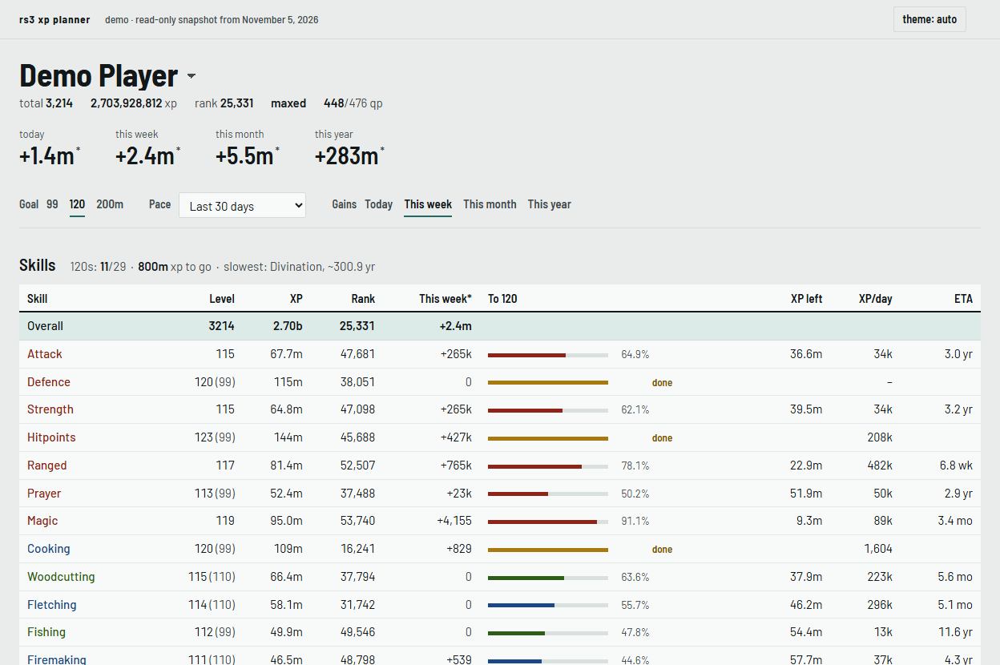
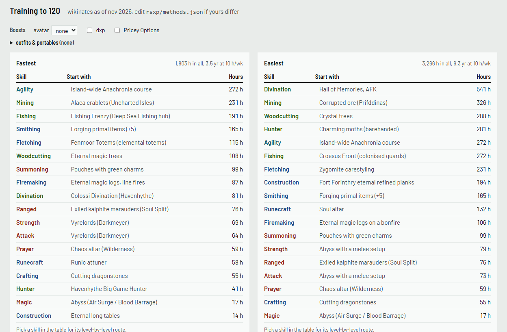

# rs3-xp-planner

I wanted to know how long all 120s would actually take. RuneMetrics was about to shut down,
and the new [Platform API](https://developer.runescape.com/platform/concepts.html) only
gives you your stats *right now*. So this polls the Hiscores every hour and keeps the
history in a SQLite file. Then it works out how far off you are.

There's a demo with my own stats (renamed) under **Website** in the About box on the right.



## what it does

- XP gained today / this week / this month / this year, using the game's resets (00:00
  UTC, Wednesday for weeks)
- every skill with its virtual level, rank, how far it is to 99 / 120 / 200m, and an ETA
- the ETA can come from your own pace over the last 7/30/90/365 days, from training
  methods (fastest or most AFK), or from an xp/hr you type in
- per-skill training routes, e.g. "Divination 113-120: Colossi, ~81 h"
- boosts: clan avatar, dxp, and outfits / portables picked per skill (only skills that
  actually have one, at their real bonus, e.g. Lumberjack 5%, portable range 21%)
- activities (clues, RuneScore, minigames), quests and your Adventurer's Log, since the API
  has them anyway



The training rates are in [`rsxp/methods.json`](rsxp/methods.json). Most come from the RS
Wiki training guides as of Nov 2026. A few are from a third-party guide, and some low-level
ones are my own rough guesses; they're marked as such. If your rates are different, just
edit the file. Pricey Options (dragon darts, burial sets etc.) are left out unless you tick
**Pricey Options**, otherwise they'd win every "fastest" route. Methods with no published
xp/hr (like Fenmoor Totems for Woodcutting) are listed under each route but not counted in
the hours.

## setup

### docker (easiest)

This is the way to go if you want it collecting 24/7 without thinking about it. You need
[Docker](https://docs.docker.com/get-docker/) (Docker Desktop on Windows/mac).

Clone this repo (or download the zip from the green Code button), then in that folder:

```bash
cp .env.example .env
```

Put your contact and RSN(s) in `.env`:

```ini
RSXP_CONTACT=your discord or github
RSXP_PLAYERS=Your Name, Alt Name
```

```bash
docker compose up -d
```

Open http://127.0.0.1:8765. Data lives in the `rsxp-data` volume, so rebuilding or updating
the container keeps your history. It restarts on its own after a reboot.

A few handy ones:

```bash
docker compose logs -f
git pull && docker compose up -d --build              # update to the latest version
docker compose exec planner python -m rsxp plan "Your Name" --target 120
```

The port is bound to `127.0.0.1` because the page has no login. If you want it on your
LAN, change the port line in `docker-compose.yml` to `"8765:8765"` at your own risk.

### without docker

Python 3.10+.

```bash
pip install -r requirements.txt
```

```bash
python -m rsxp serve
```

Go to http://127.0.0.1:8765 and add your RSN. On Windows you can just run
`start_planner.bat`. It only collects while it's running, so either stick it in
`shell:startup` or use Docker.

Jagex asks that API clients identify themselves, so set a contact first:

```bash
set RSXP_CONTACT=your discord or github
```

(Use `export` on Linux/mac.)

There's a CLI too:

```text
python -m rsxp add "Name"
python -m rsxp poll "Name"
python -m rsxp plan "Name" --target 120
python -m rsxp import-backfill "Name"   # old RuneMetrics data, see below
python -m rsxp export-demo "Name"       # rebuilds docs/, swaps the name for "Demo Player"
```

Tests: `python -m pytest tests`

## notes

- **It's polite to the API.** One request at a time, 5 s+ apart, with a proper
  User-Agent. It backs off on 429/5xx and stops for 30 min if things keep failing.
  Hiscores only change when you log out or hop, so hourly is plenty.
- **RuneMetrics history.** RuneMetrics went offline on 10 Nov 2026. If you grabbed your
  monthly XP before that with `runemetrics_backfill.py`, `import-backfill` loads it. It's
  monthly totals only, so gains inside those months are interpolated (they show with a `*`).
- **Not affiliated with Jagex.** Rates are estimates, don't @ me if Colossi is slower for
  you.

## todo

- [ ] ironman hiscores (`hiscore_ironman` etc.), only the main hiscores are read right now
- [ ] Invention virtual levels past 120 (elite curve isn't tabulated)
- [ ] Fenmoor Totems woodcutting rate, once anyone publishes one
- [ ] handle name changes properly; for now just add the new name
- [ ] Slayer rates are guesses, the wiki has no per-hour figures

MIT
