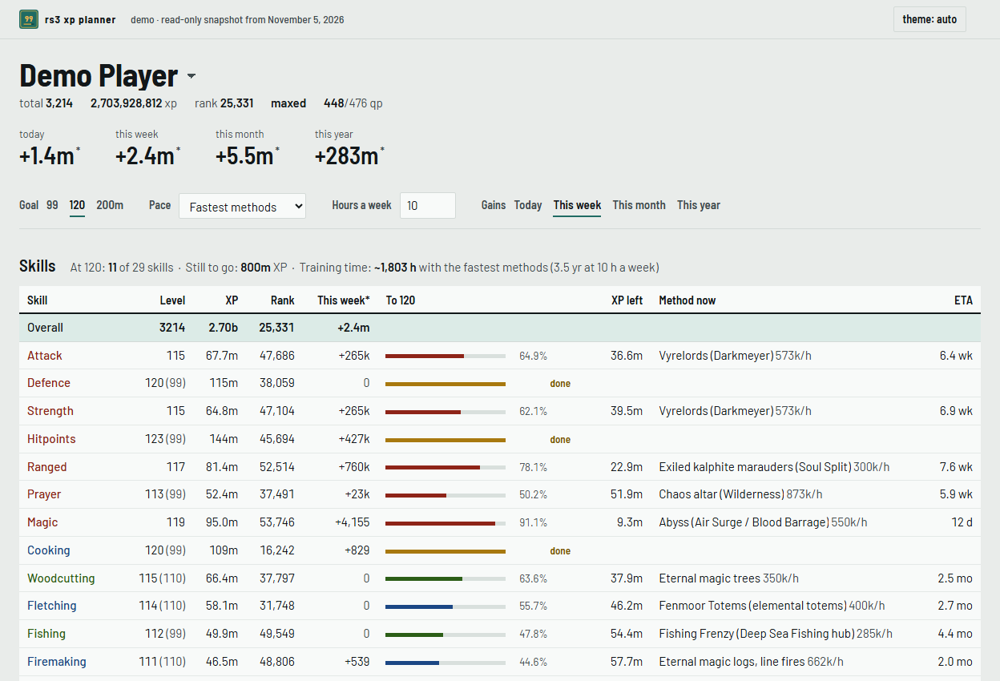
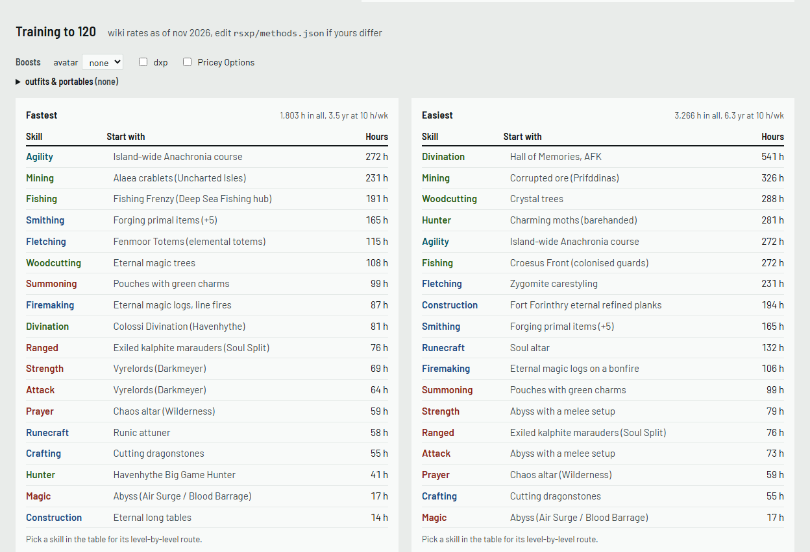
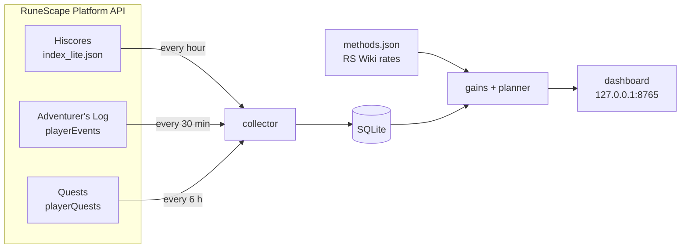

<div align="center">


# rs3-xp-planner

**Your RuneScape 3 XP history, and how far every skill is from 99, 120 and 200m.**
<br>Self-hosted, and built only on Jagex's new RuneScape Platform API.

[](../../actions/workflows/tests.yml)


[**Live demo**](../../deployments/github-pages) &nbsp;·&nbsp; [Quick start](#quick-start) &nbsp;·&nbsp; [Features](#features) &nbsp;·&nbsp; [How it works](#how-it-works) &nbsp;·&nbsp; [FAQ](#faq)

<br>

<picture>
  <source media="(prefers-color-scheme: dark)" srcset="assets/screenshots/dashboard-dark.png">
  
</picture>

</div>

## Why

I wanted to know how long all 120s would actually take. In November 2026 Jagex opened
the [RuneScape Platform API](https://developer.runescape.com/platform/concepts.html),
which gives you your current stats, quests and Adventurer's Log, but no history. RuneMetrics
used to have monthly XP, and it's discontinued on 10 November 2026.

So this keeps the history itself. It checks the Hiscores every hour, saves every change to
a SQLite file on your machine, and works out the rest from there.

## Features

<table>
<tr>
<td width="50%" valign="top">

**XP history**<br>
Gains for today, this week, this month and this year, using the game's own resets (00:00
UTC, and Wednesdays for the week). There's a chart of XP by skill, and per-day or
per-month bars for each skill.

</td>
<td width="50%" valign="top">

**Goals for 99, 120 and 200m**<br>
Every skill gets its virtual level past the cap, a progress bar, the XP left and an ETA.
Invention uses its elite XP curve.

</td>
</tr>
<tr>
<td valign="top">

**Training routes**<br>
Level by level, the fastest or the most AFK method and how many hours each stretch
takes. Rates come from the RS Wiki training guides as of November 2026, including
Colossi Divination and Fenmoor Totems. Slayer creatures count for combat
XP once your Slayer level allows them, and for combat skills you can pick any of 21
creatures and enter your own kills per hour.

</td>
<td valign="top">

**Boosts per skill**<br>
Tick the outfits and portables you actually own, at their real bonus: Lumberjack 5%,
portable range 21% and so on. Clan avatar and DXP too. Pricey Options like dragon darts
stay out unless you ask.

</td>
</tr>
<tr>
<td valign="top">

**Everything else the API has**<br>
Ranks, Hiscores activities (RuneScore, clues by tier, minigames), quests (what you can
start right now) and your Adventurer's Log.

</td>
<td valign="top">

**Runs itself**<br>
`docker compose up -d` and it collects 24/7, restarts after reboots and keeps your
history in a volume. It has light and dark themes and works on a phone.

</td>
</tr>
</table>

<picture>
  <source media="(prefers-color-scheme: dark)" srcset="assets/screenshots/charts-dark.png">
  
</picture>

<picture>
  <source media="(prefers-color-scheme: dark)" srcset="assets/screenshots/training-dark.png">
  
</picture>

## Quick start

You need [Docker](https://docs.docker.com/get-docker/). Clone the repo (or download the
zip), then in that folder:

```bash
cp .env.example .env
```

Put your contact and RSN(s) in `.env`:

```ini
RSXP_CONTACT=your discord or github
RSXP_PLAYERS=Your Name, Alt Name
```

```bash
docker compose up -d
```

Then open **http://127.0.0.1:8765**. To update later, run
`git pull && docker compose up -d --build`. Your history stays in the `rsxp-data` volume.

<details>
<summary><b>Without Docker</b></summary>

<br>

You need Python 3.10 or newer.

```bash
pip install -r requirements.txt
```

```bash
set RSXP_CONTACT=your discord or github
```

```bash
python -m rsxp serve
```

Use `export` instead of `set` on macOS and Linux. On Windows, `start_planner.bat` starts
it and opens the browser. It only collects while it's running, so put it in
`shell:startup` if you go this way.

</details>

## How it works



**Where the history comes from:**

- **Hiscores snapshots.** One request an hour. A new row is only saved when your XP
  actually changed. Hiscores update when you log out or hop worlds.
- **Your Adventurer's Log.** Every 2M XP milestone ("70,000,000 XP in Construction")
  and every level-up is an exact XP point with a timestamp. That gives each skill some
  history from before you started tracking. These gains are marked `*`, because the log
  only keeps your latest events and sometimes batches level-ups.
- **Monthly history you already saved (optional).** If your database has month-start
  totals saved from RuneMetrics before it closed on 10 Nov 2026, they're used too. That
  gives up to a year of history. They're read from your local file, never fetched, and are
  approximate inside each month.

**Where the ETAs come from:** your own recent pace, the training routes, or an XP/hr you
type in. You pick which on the page.

## Configuration

| Setting | What it's for |
|---|---|
| `RSXP_CONTACT` | **Please set this.** It goes in the User-Agent, as Jagex [asks](https://developer.runescape.com/platform/best-practices.html), so they can reach you if something's wrong |
| `RSXP_PLAYERS` | Comma-separated names to track on startup. You can also add them on the page |
| `RSXP_DB` | Where the SQLite file lives. Docker uses `/data/rsxp.sqlite3` |
| `RSXP_USER_AGENT` | Replaces the whole User-Agent if you'd rather write your own |

Training rates, outfit and portable bonuses all live in
[`rsxp/methods.json`](rsxp/methods.json). If your rates differ, edit that file and the
planner picks up the change.

<details>
<summary><b>Command line</b></summary>

<br>

```text
python -m rsxp serve [--port 8765]         dashboard + hourly collector
python -m rsxp add "Name"                  track a player
python -m rsxp poll ["Name"]               check Hiscores now
python -m rsxp plan "Name" --target 120    print the plan in the terminal
python -m rsxp demo-fixture "Name"         refresh demo/fixture.json (shown as "Demo Player")
python -m rsxp build-demo                  build the demo site into _site/ (CI does this)
```

With Docker, put `docker compose exec planner` in front, for example
`docker compose exec planner python -m rsxp plan "Name"`.

</details>

<details>
<summary><b>Being nice to Jagex's API</b></summary>

<br>

Everything goes through one client ([`rsxp/client.py`](rsxp/client.py)):

- One request at a time, at least 5 seconds apart, with jitter.
- An identifying User-Agent with your contact on every request.
- Only 429s, 5xx errors and timeouts are retried, with backoff and `Retry-After`. Redirects
  are never followed.
- After three failures in a row, it stops asking for 30 minutes.
- Hiscores are checked hourly. The Adventurer's Log is fetched every 30 minutes, quests
  every 6 hours, and names Hiscores can't find once a day.

</details>

<details>
<summary><b>Project layout</b></summary>

<br>

| Path | What's in it |
|---|---|
| `rsxp/client.py` | Rate-limited Platform API client |
| `rsxp/collector.py` | Polling schedule |
| `rsxp/db.py` | SQLite storage |
| `rsxp/gains.py` | History from snapshots and Adventurer's Log points |
| `rsxp/planner.py` | Goals and ETAs |
| `rsxp/training.py` | Training routes and boosts |
| `rsxp/methods.json` | Methods, rates, outfits and portables |
| `rsxp/server.py` | Local API |
| `rsxp/static/` | The dashboard: `index.html`, `app.css`, `app.js`, `theme.js`, `logo.svg` |
| `rsxp/demo.py` | Demo fixture and static site builder |
| `demo/fixture.json` | The demo's raw data, one file. The site is built from it in CI and never committed |

</details>

## FAQ

**Why does my history only start today?**
The API has no history endpoint, so the planner only knows what it has seen. Each skill
does get some older points from your Adventurer's Log milestones, and any monthly history
already in your database is used too. Leave it running and it fills in.

**Why does a skill say "no recent XP"?**
Recent-pace ETAs need at least a day of history with some XP in it. Switch the pace to
**Fastest methods** to get a time from the training rates instead.

**Can I open it on my phone or another PC?**
The port is bound to `127.0.0.1` because there's no login. If you want it on your LAN,
change the port line in `docker-compose.yml` to `"8765:8765"`, at your own risk.

**Ironman?**
Not yet. Only the main Hiscores are read for now (see the TODO list below).

## TODO

- [ ] Ironman Hiscores (`hiscore_ironman` and friends)
- [ ] Invention virtual levels past 120 (the elite curve isn't tabulated)
- [ ] A Fenmoor Totems Woodcutting rate, once someone publishes one
- [ ] Proper name-change handling. For now, add the new name
- [ ] Slayer rates: the wiki has no per-hour figures, so these are guesses

## Credits

The stats come from Jagex's [RuneScape Platform API](https://developer.runescape.com/platform/concepts.html).
Training rates come from the [RuneScape Wiki](https://runescape.wiki/) training guides.
Charts are drawn with [Chart.js](https://www.chartjs.org/), in the [Barlow](https://fonts.google.com/specimen/Barlow)
typeface.

This is a fan project and isn't affiliated with Jagex. RuneScape is a trademark of Jagex
Ltd. Training rates are estimates.

[MIT license](LICENSE)
