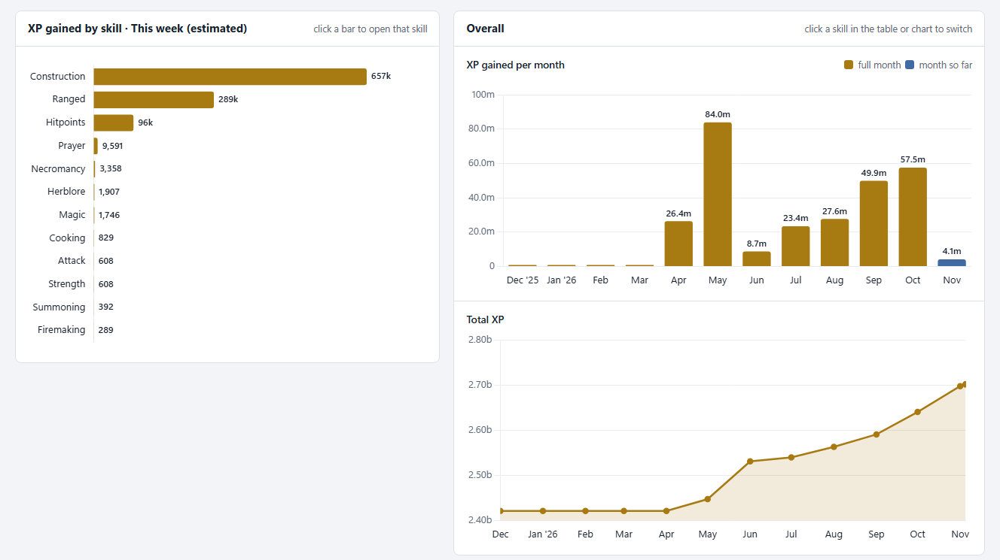
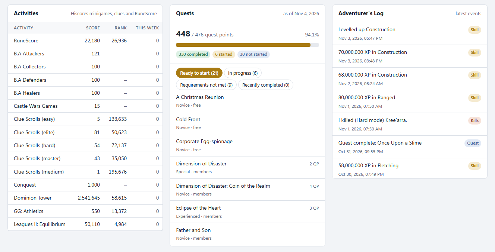

<div align="center">

# RS3 XP Planner

**See where your RuneScape 3 XP went, and how far every skill is from 99, 120 and 200m.**


[**Live demo**](../../deployments/github-pages) · [Features](#features) · [Quick start](#quick-start) · [Commands](#commands) · [How it works](#how-it-works)

<picture>
  <source media="(prefers-color-scheme: dark)" srcset="docs/screenshots/dashboard-dark.png">
  
</picture>

</div>

A self-hosted dashboard built on the [RuneScape Platform API](https://developer.runescape.com/platform/concepts.html)
that Jagex launched in November 2026. It checks the Hiscores every hour and keeps your XP
history in a local SQLite file, because the API itself has no history endpoint. From that
history it turns your goals into a training plan. No account, no API key, no cloud.

## Features

### Where your XP went

- **Gains by period:** today (since the 00:00 UTC reset), this week (since the Wednesday
  reset), this month and this year.
- **XP gained by skill:** a chart for the chosen period. Click a bar to open that skill.
- **Per skill:** monthly gains and a total XP line, with your goal marked when it's in range.

<picture>
  <source media="(prefers-color-scheme: dark)" srcset="docs/screenshots/charts-dark.png">
  
</picture>

### Goals for 99, 120 and 200m

- Virtual levels past each skill's cap, with Invention's elite XP curve.
- Progress bars, XP left and a finish date for every skill.
- The finish date can use your own recent pace (7, 30, 90 or 365 days), the fastest or
  easiest training methods, or your own XP/hr and hours a week.

### Training routes

- **Level by level:** which method to use from each level to your goal, and how many hours
  each stretch takes.
  - **Fastest:** the highest XP/hr unlocked at each level.
  - **Easiest:** AFK methods first, then low-effort ones.
- **Up-to-date methods:** checked against the RuneScape Wiki's training guides (November
  2026), including 2026 content such as Colossi Divination, Fenmoor Totems, the Runic
  attuner and Havenhythe Big Game Hunter.
- **Labelled sources:** every rate is tagged as a wiki figure, a third-party guide figure or
  an estimate, and all of them can be edited in [`rsxp/methods.json`](rsxp/methods.json).
- **XP boosts:** clan avatar, skilling outfit, portable stations and Double XP.
  Gold-sink methods stay out unless you allow them.

<picture>
  <source media="(prefers-color-scheme: dark)" srcset="docs/screenshots/training-dark.png">
  
</picture>

### Everything else the API offers

- Hiscores activities: RuneScore, clue scrolls by tier and minigames.
- Quests: quest points, and what's ready to start, in progress or recently completed.
- The Adventurer's Log, with each event tagged by type.

<picture>
  <source media="(prefers-color-scheme: dark)" srcset="docs/screenshots/panels-dark.png">
  
</picture>

## Quick start

You need Python 3.10 or newer.

1. **Install the requirements.**

   ```bash
   pip install -r requirements.txt
   ```

2. **Say who you are.** Jagex [asks every client](https://developer.runescape.com/platform/best-practices.html)
   to identify itself with a contact. On Windows `cmd`:

   ```bash
   set RSXP_CONTACT=@yourname on Discord
   ```

   On macOS or Linux, use `export RSXP_CONTACT=...` instead.

3. **Start the planner.**

   ```bash
   python -m rsxp serve
   ```

   Open **http://127.0.0.1:8765** and use **Track** to add your display name. On Windows,
   double-clicking `start_planner.bat` does the same.

> [!TIP]
> History only builds while the planner is running. Start it when you log in to your PC,
> with Task Scheduler or a shortcut in `shell:startup`.

## Commands

| Command | What it does |
|---|---|
| `python -m rsxp serve` | Run the dashboard and the hourly collector |
| `python -m rsxp add "Name"` | Track a player |
| `python -m rsxp poll ["Name"]` | Check Hiscores now: one player, or every player that's due |
| `python -m rsxp plan "Name" --target 120 --window 30` | Print the plan in the terminal |
| `python -m rsxp import-backfill "Name"` | Load saved RuneMetrics monthly XP |
| `python -m rsxp export-demo "Name"` | Rebuild the static demo in `docs/` (the name is replaced with "Demo Player") |
| `python -m pytest tests` | Run the tests |

## How it works

<details>
<summary><b>How it treats the API</b></summary>

All requests go through one client ([`rsxp/client.py`](rsxp/client.py)), which works like this:

- One request at a time, with at least 5 seconds plus jitter between requests.
- An identifying User-Agent on every request.
- Redirects are never followed.
- Only 429, 5xx and network errors are retried, honouring `Retry-After`.
- After 3 failed calls in a row, all requests pause for 30 minutes.
- Hiscores are checked hourly; they only change when you log out or hop worlds.
- "Update now" works at most once per 5 minutes per player.
- Player Events are fetched every 30 minutes, and Player Quests every 6 hours.
- Players that Hiscores can't find are checked once a day.

</details>

<details>
<summary><b>How history is stored</b></summary>

- **When XP changes:** a new snapshot is saved.
- **When it doesn't:** the latest snapshot's `seen_until` time moves forward. That places
  every gain within one poll interval without storing duplicate rows.
- **Before you installed it:** RuneMetrics' monthly XP endpoint went offline on
  10 November 2026 and has no replacement. If you saved its responses with
  [`runemetrics_backfill.py`](runemetrics_backfill.py) before then, `import-backfill`
  turns them into month-start snapshots. Gains inside those months are interpolated, and
  the dashboard labels them as estimates.

</details>

<details>
<summary><b>How training routes are calculated</b></summary>

1. **Split the remaining XP** into stretches at every level where a new method unlocks.
2. **Pick a method** for each stretch: the highest XP/hr for *fastest*, or the most relaxed
   effort (AFK, then low, then high) for *easiest*.
3. **Time each stretch** as XP ÷ (base rate × boosts).

Some methods are left out of the hours:

- Methods with no published hourly rate, such as Fenmoor Totems Woodcutting and bossing.
- Gold-sink methods, such as dragon darts and burial sets, unless you allow them.

Both kinds are still listed under each route as "also possible".

</details>

<details>
<summary><b>Project layout</b></summary>

| Path | Contents |
|---|---|
| `rsxp/client.py` | Rate-limited API client |
| `rsxp/db.py` | SQLite schema and storage |
| `rsxp/collector.py` | Polling schedule |
| `rsxp/gains.py` | XP-over-time queries |
| `rsxp/planner.py` | Goals and finish dates |
| `rsxp/training.py` | Training routes |
| `rsxp/methods.json` | Training methods and boosts |
| `rsxp/server.py` | Local API |
| `rsxp/static/index.html` | Dashboard |
| `rsxp/demo.py` | Static demo export |
| `docs/` | Built demo for GitHub Pages |
| `design/` | Phase 1 blueprint |
| `tests/` | Tests |

</details>

## Disclaimer

This is a fan project, not affiliated with or endorsed by Jagex. RuneScape is a trademark
of Jagex Ltd. Training rates are estimates for planning, not guarantees.

## License

[MIT](LICENSE)
